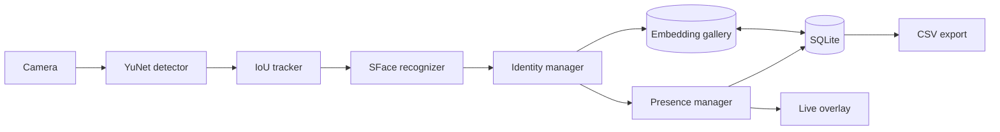

# Face Presence Logger

[](https://github.com/graciadavid-coder/face-presence-logger/actions/workflows/tests.yml)


Face Presence Logger is a lightweight, CPU-only face recognition and presence logging application for a single camera. It detects faces in a video stream, assigns a local identifier to each new person, recognizes returning people, and records how long each person stays in view.

The runtime uses OpenCV's DNN module with two ONNX models from OpenCV Zoo. It does not require a GPU, a deep-learning framework, or a cloud service.

## Quick start

```bash
git clone https://github.com/graciadavid-coder/face-presence-logger.git
cd face-presence-logger
python -m venv .venv
# Windows: .venv\Scripts\activate.bat
# macOS:   source .venv/bin/activate
python -m pip install -r requirements.txt
python -m face_presence setup
python -m face_presence run
```

See [Installation](#installation) for PowerShell, Command Prompt, and macOS details.

## Status

The MVP is complete and covered by automated tests. The runtime is CPU-only and relies on OpenCV's DNN module rather than a full deep-learning framework. GitHub Actions is configured to run linting, tests, and repository hygiene checks on Linux, Windows, and macOS.

## How it works



1. **Detection.** YuNet locates faces and their five facial landmarks on a reduced copy of each frame.
2. **Tracking.** A lightweight IoU tracker follows each face between detection passes.
3. **Recognition.** SFace aligns each face and produces a 128-dimensional embedding. The embedding is compared against the local gallery using cosine similarity.
4. **Enrollment.** A face that does not match an existing person is confirmed across several frames and stored as `Person_001`, `Person_002`, and so on.
5. **Presence.** Each confirmed person opens a session with a start time, last detection time, and duration. A heartbeat updates SQLite while the person is visible, and the session closes after a configurable absence period.
6. **Storage.** SQLite stores known people, sessions, and lifecycle events. Sessions can be exported to CSV for reporting.

## Features

- CPU-only detection and recognition.
- Automatic enrollment with local identifiers.
- Presence sessions with entry time, last detection, and duration.
- SQLite storage and CSV export.
- Live overlay with face boxes, identifiers, and timers.
- Selection of the default camera or an external camera.
- Local-only data, with runtime artifacts excluded from version control.

## Requirements

- Python 3.11 or newer.
- A camera accessible to the operating system.
- Windows 10 or newer, or macOS 13 or newer. Linux is supported through V4L2.
- Internet access during the first model setup.

## Installation

### Windows (PowerShell)

```powershell
git clone https://github.com/graciadavid-coder/face-presence-logger.git
cd face-presence-logger
python -m venv .venv
.venv\Scripts\Activate.ps1
python -m pip install --upgrade pip
python -m pip install -r requirements.txt
```

If PowerShell blocks the activation script, allow it for the current session:

```powershell
Set-ExecutionPolicy -Scope Process Bypass
```

### Windows (Command Prompt)

```bat
git clone https://github.com/graciadavid-coder/face-presence-logger.git
cd face-presence-logger
python -m venv .venv
.venv\Scripts\activate.bat
python -m pip install --upgrade pip
python -m pip install -r requirements.txt
```

Activation scripts are shell-specific: use `Activate.ps1` in PowerShell and `activate.bat` in Command Prompt. You can also skip activation entirely and call the environment interpreter directly:

```bat
.venv\Scripts\python.exe -m face_presence --help
```

### macOS

```bash
git clone https://github.com/graciadavid-coder/face-presence-logger.git
cd face-presence-logger
python3 -m venv .venv
source .venv/bin/activate
python -m pip install --upgrade pip
python -m pip install -r requirements.txt
```

The first time the application opens a camera, macOS asks for camera access. Grant permission to the terminal or IDE that launches the process. The prompt does not appear again unless the permission is reset.

### Environment isolation

If your shell defines `PYTHONPATH`, clear it before running the project so packages from other environments are not imported:

```powershell
# Windows
$env:PYTHONPATH = ""
```

```bash
# macOS
unset PYTHONPATH
```

## Download the models

```bash
python -m face_presence setup
```

The command downloads YuNet and SFace from a pinned OpenCV Zoo revision, verifies their SHA-256 digests, creates the runtime folders under `data/`, and initializes the SQLite database. The models are not committed to the repository.

## Discover cameras

```bash
python -m face_presence cameras
```

The command probes camera indexes and prints the backend and resolution of each device it can open. Set the desired index in `config.toml`:

```toml
[camera]
index = 1
```

The backend is selected automatically: Media Foundation with a DirectShow fallback on Windows, AVFoundation on macOS, and V4L2 on Linux. A specific backend can be forced with `[camera].backend`.

## Run the live preview

```bash
python -m face_presence run
```

Override the camera index from `config.toml`:

```bash
python -m face_presence run --camera 1
```

If you prefer not to activate the virtual environment, call its interpreter directly:

```bat
.venv\Scripts\python.exe -m face_presence run
```

The window draws a box and a temporary `Face NN` label while a face is being confirmed. Once the identity is stable, the label becomes `Person_001`, `Person_002`, etc., the box turns green, and a live session timer starts. New faces are enrolled after several consistent detections. Press `q` or `Esc`, or close the window, to quit. Frames stay in memory; only the embedding and session metadata are written to SQLite.

The project can also be installed as a console command:

```bash
python -m pip install -e .
face-presence-logger run
```

## Command reference

| Command | Purpose |
| --- | --- |
| `python -m face_presence setup` | Download and verify models, create runtime folders, initialize SQLite |
| `python -m face_presence cameras` | List cameras, backends, and resolutions |
| `python -m face_presence run` | Start the live preview |
| `python -m face_presence export` | Export sessions to CSV |
| `python -m face_presence --help` | Show the full command line help |

## Known people

Enrollment is automatic. A new face is sampled across several frames, averaged into a single normalized embedding, and stored with a local identifier. No image is saved. The gallery is loaded from SQLite at startup, so people are recognized again after a restart.

Before creating a new person, the averaged embedding is checked against the gallery with a slightly more permissive threshold than normal recognition. This reduces duplicate enrollments when the same person appears under a different angle or lighting. Both thresholds are configurable in `config.toml`.

To reset the gallery, stop the application and delete the database:

```bash
rm data/presence.db
```

On Windows, delete `data\presence.db` and any `presence.db-wal` or `presence.db-shm` companions. The database is ignored by Git and should never be committed.

## Presence sessions and exports

A session starts when a person is confirmed and ends after `presence.absence_timeout_s` seconds without detections. `started_at` is the first confirmation, `last_seen_at` is the last detection, and `duration_s` is the observed span between them; the absence grace period is not added to the duration. Active sessions are updated with a heartbeat every `presence.heartbeat_s` seconds. If the process stops abruptly, the next startup closes stale sessions using their last heartbeat.

### Data model

| Table | Contents |
| --- | --- |
| `persons` | Label, 128-dimensional embedding, creation time |
| `sessions` | Person, camera index, start, last seen, end, duration, status |
| `events` | Enrollment and session lifecycle audit entries |

Export sessions to CSV:

```bash
python -m face_presence export --out data/exports/sessions.csv
```

Filter by start date (UTC):

```bash
python -m face_presence export --since 2026-11-01 --until 2026-11-30
```

The CSV is written with a UTF-8 BOM for Excel compatibility. Columns: `session_id`, `person_label`, `camera_index`, `started_at_utc`, `last_seen_at_utc`, `ended_at_utc`, `duration_seconds`, `duration_hhmmss`, and `status`. Exports are ignored by Git.

## Example output

```text
INFO: Camera 0 opened with msmf at 640x480
INFO: Known people loaded: 2
INFO: Enrolled Person_003
INFO: Recognized Person_001
INFO: Presence session started for person 3
INFO: Presence session closed after 42.3 s
```

```csv
session_id,person_label,camera_index,started_at_utc,last_seen_at_utc,ended_at_utc,duration_seconds,duration_hhmmss,status
3,Person_001,0,2026-11-13T10:00:00Z,2026-11-13T10:00:42Z,2026-11-13T10:00:42Z,42.00,00:42,closed
```

## Configuration

All settings live in `config.toml`. Relative paths are resolved from the directory that contains the file.

| Section | Key | Purpose |
| --- | --- | --- |
| `camera` | `index` | Camera device index |
| `camera` | `backend` | `auto`, `dshow`, `msmf`, `avfoundation`, `v4l2`, or `default` |
| `detection` | `input_width` | Width used for face detection |
| `detection` | `interval_frames` | Frames between detection passes |
| `recognition` | `match_threshold` | Minimum cosine similarity for a match |
| `recognition` | `match_margin` | Required lead over the second-best match |
| `recognition` | `enroll_threshold` | Similarity used to detect a duplicate before enrollment |
| `recognition` | `enroll_margin` | Margin used by the duplicate check |
| `recognition` | `confirm_votes` | Consecutive matches required before assigning a person |
| `recognition` | `enroll_samples` | Samples averaged when enrolling a new person |
| `recognition` | `min_face_px` | Minimum face size eligible for recognition |
| `presence` | `absence_timeout_s` | Seconds without a detection before a session closes |
| `presence` | `heartbeat_s` | Seconds between database heartbeats for active sessions |

## Project layout

```
face-presence-logger/
├─ .github/workflows/tests.yml
├─ config.toml
├─ face_presence/
│  ├─ camera.py          # camera discovery and capture
│  ├─ cli.py             # command line interface
│  ├─ config.py          # TOML loading and validation
│  ├─ detection.py       # YuNet detection wrapper
│  ├─ formatting.py      # shared duration formatting
│  ├─ identity.py        # confirmation and enrollment state
│  ├─ model_assets.py    # model download and checksum verification
│  ├─ overlay.py         # boxes, labels and status panel
│  ├─ pipeline.py        # live preview loop
│  ├─ presence.py        # sessions, timers and heartbeats
│  ├─ recognition.py     # SFace and in-memory gallery
│  ├─ storage.py         # SQLite persistence and CSV export
│  └─ tracking.py        # IoU tracker
├─ scripts/
│  ├─ check_repo_hygiene.py
│  └─ pre-commit
├─ tests/
├─ models/               # downloaded ONNX files (ignored by Git)
└─ data/                 # database and CSV exports (ignored by Git)
```

## Data and privacy

- `data/` is excluded from version control. It holds the SQLite database and CSV exports.
- The database stores one 128-dimensional embedding per person (512 bytes), never a face image.
- Sessions and CSV exports contain timestamps and session durations, never images or embeddings.
- The live preview processes frames in memory and does not write them to disk.
- The application never writes camera frames to disk.
- Face embeddings are biometric templates. Treat `data/presence.db` as sensitive and do not commit or share it.
- The repository ships a hygiene checker and a pre-commit hook template that block runtime databases, model files, captured media, and exports from entering Git.
- Deleting `data/` removes all local records and allows the application to start from a clean state.
- No data leaves the machine. There is no telemetry and no cloud dependency at runtime.

Use the application only where you have the right to process images of the people involved. Depending on your jurisdiction, you may need consent, signage, or a legal basis for biometric processing.

## Design decisions

- **YuNet + SFace instead of a full deep-learning stack.** Two small ONNX models cover detection, alignment, and 128-dimensional embeddings without PyTorch, TensorFlow, dlib, or CUDA.
- **Track first, recognize second.** Detection runs every few frames and an IoU tracker keeps boxes stable; SFace only runs when a track needs an identity. This keeps the preview responsive on CPU.
- **Votes instead of single-frame decisions.** A person is assigned after consecutive matching observations, which avoids flicker and accidental enrollments.
- **SQLite instead of a server.** The application runs fully offline; SQLite provides transactions, indexes, and zero deployment overhead.
- **Templates, not images.** Only normalized embeddings, timestamps, and session metadata are stored.

## Limitations

- No liveness or anti-spoofing detection: a printed photo or a screen can be detected as a face. Do not use this project as an access-control system.
- Recognition works best with visible, reasonably sized frontal faces and stable lighting.
- One embedding is stored per person. Large appearance changes may require a new enrollment.
- A single camera is processed per run.
- Thresholds are a trade-off: lower values accept more matches but can merge different people; higher values reduce false matches but can create duplicate identities.

## Troubleshooting

### `ModuleNotFoundError: No module named 'cv2'`

The command is using a Python interpreter outside the virtual environment. Activate the environment or call its interpreter directly:

```bat
.venv\Scripts\python.exe -m face_presence run
```

### The camera is not detected

```bash
python -m face_presence cameras
```

Close other applications that may be using the camera. On macOS, grant camera permission to the terminal or IDE. On Windows, Media Foundation is preferred with a DirectShow fallback.

### `PYTHONPATH` conflicts

If your shell exports `PYTHONPATH`, clear it for this project:

```powershell
$env:PYTHONPATH = ""
```

```bash
unset PYTHONPATH
```

### The preview is slow

Increase `detection.interval_frames`, reduce the capture resolution, or close other CPU-heavy applications. The adaptive interval raises the detection interval automatically when the frame rate drops.

### Duplicate or merged identities

Adjust `recognition.match_threshold` and `recognition.enroll_threshold`. Lower values match more easily and reduce duplicates but can merge different people; higher values are stricter.

### The database is locked

Close other instances of the application before exporting. SQLite uses WAL mode, so reads normally continue while the preview is running.

## Future work

- Liveness and anti-spoofing checks.
- Multiple embeddings per person for appearance changes.
- Multi-camera sessions.
- Optional REST API or web dashboard.
- Retention policies and a management command for deleting individuals.

## Development

```bash
python -m pip install -r requirements-dev.txt
python -m ruff check .
python -m pytest
python scripts/check_repo_hygiene.py
```

Install the local pre-commit hook so the hygiene check runs before every commit:

```bash
# macOS / Linux
cp scripts/pre-commit .git/hooks/pre-commit
chmod +x .git/hooks/pre-commit

# Windows
copy scripts\pre-commit .git\hooks\pre-commit
```

The test suite covers configuration, model verification, camera backend selection, detection scaling, IoU tracking, overlay rendering, identity confirmation, duplicate protection, enrollment, SQLite persistence, presence sessions, CSV export, repository hygiene, and pipeline helpers without requiring a camera or the ONNX models. GitHub Actions is configured to run lint, tests, and the hygiene check on Linux, Windows, and macOS.

## Contributing

Issues and pull requests are welcome. Run the development checks before submitting a change, and never commit runtime databases, exports, or captured media.

## Models

The models are downloaded from [OpenCV Zoo](https://github.com/opencv/opencv_zoo) at a pinned revision and verified against fixed SHA-256 digests. They remain subject to their original licenses; see the model cards in the OpenCV Zoo repository for details.

## Author

David Gracia — [github.com/graciadavid-coder](https://github.com/graciadavid-coder)

## Acknowledgements

YuNet and SFace are provided by [OpenCV Zoo](https://github.com/opencv/opencv_zoo). The application is built on OpenCV.

## License

MIT License. Copyright (c) 2026 David Gracia.
